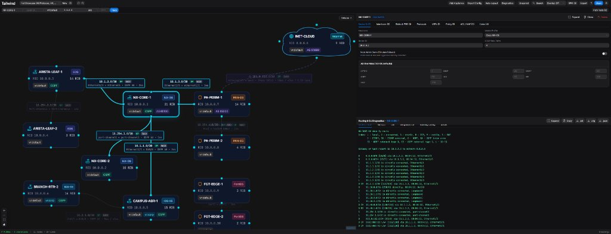

# Tailwind — Multi-Vendor Network Control-Plane Simulator

Tailwind is a browser-based, multi-vendor network routing, switching, security, and path-verification simulator. It converges control-plane routing tables (RIB/FIB) in a Web Worker, visualizes topologies on an interactive canvas, traces forward and return packet paths with asymmetric-routing detection, and generates/imports vendor-native CLI configurations.



---

## Key Features

- **19 Vendor & Cloud Profiles** ([`src/engine/vendorProfiles.ts`](src/engine/vendorProfiles.ts)):
  - **Appliances / Routers / Firewalls**: Cisco IOS-XE, Cisco NX-OS, Cisco IOS-XR, Cisco SD-WAN (Viptela), Palo Alto PAN-OS, Palo Alto Prisma SD-WAN (ION), Forcepoint NGFW (FRR), Arista EOS, HPE Aruba AOS-CX, Juniper Junos, MikroTik RouterOS, Fortinet FortiGate, Check Point Gaia, VyOS.
  - **Cloud / WAN Abstractions**: MPLS WAN Cloud (`mpls-cloud`), Internet Transit / DIA (`internet-cloud`), AWS Transit Gateway (`aws-cloud`), Azure Virtual WAN (`azure-cloud`), Google Cloud Router (`gcp-cloud`).
  - **Vendor-Gated Capabilities**: Inspector controls, protocol options, LAG modes (LACP / PAgP / Static), FHRP (HSRP / VARP / VRRP), cluster modes (vPC, MLAG, FGCP, PAN-OS HA/HSCI, Forcepoint CVI), and terminology adapt automatically to each vendor.
- **Control-Plane Protocols & RFC Standards**:
  - **IGPs & Static**: Connected, Static (with IP SLA tracking), **OSPF / OSPFv3 (RFC 2328)** (areas, stub/totally-stubby/NSSA `no-summary`, auth, custom timers, area-type & MTU mismatch checks, priority-0 `2-Way`, virtual links, E2 ASBR internal-cost tie-breaking, sham-links, `passive-interface default` / `no passive-interface`), **EIGRP (RFC 7868)** (DUAL feasible successors, variance, full K1–K5 composite metric, K-value mismatch detection, external AD 170, custom timers), **IS-IS (ISO/IEC 10589 & RFC 1195/5302/5305/5120)** (L1/L2, Area ID & System-ID validation, ATT-bit default route, L1 > L2 preference, overload bit, wide/narrow metrics, L2-to-L1 leaking with Up/Down bit, IPv6 MT), **RIPv1 / RIPv2**.
  - **BGP (RFC 4271)**: eBGP / iBGP, route reflectors, confederations, ECMP multipath (`maxPaths`), MED non-transitivity across eBGP, BGP Identifier collision & Hold Time validation, communities, AS-path regex, AIGP (RFC 7311), RPKI ROA validation, FlowSpec, Graceful Restart, BFD.
  - **Overlays, WAN & Switching**: Cisco SD-WAN (OMP / TLOC / TLOC-Extension / AAR SLA), **LISP (RFC 9300 & RFC 9301)** (EID/RLOC, IID isolation, priority 255 exclusion, MS/MR reachability, xTR/PxTR/PiTR/PeTR roles), VXLAN BGP EVPN, MPLS LDP / SR-MPLS / MPLS L3VPN (toggleable per device), 802.1Q sub-interface multiplexing, LACP / PAgP / Static Port-Channels, IEEE 802.1w RSTP, LLDP, PIM-SM.
  - **VRFs, Policy & Security**: Workspace-global VRFs with cross-device dropdown reuse, multi-VRF routing & route leaking, Prefix-Lists, Route-Maps (including route tags), PBR / PBF / FBF, Zone-based ACLs, pre-routing DNAT, post-routing SNAT, NAT64, uRPF, 802.1X, 802.1AE MACsec.
- **Editable Running-Config & Live Validation**:
  - Edit any device's Running-Config directly in the CLI panel with live syntax/typo/IP/VLAN validation (`validateRunningConfig`) and apply changes directly back into the live topology and routing solver.
  - Multi-vendor `passive-interface` parsing and formatting across Cisco IOS-XE, Cisco NX-OS, Arista EOS, Forcepoint FRR, Juniper Junos, Fortinet FortiGate, Palo Alto PAN-OS, and MikroTik RouterOS.
- **Live Packet Tracer & Path Test Matrix**:
  - Forward and return path computation (`returnTrace`), asymmetric routing detection (`ASYMMETRIC ROUTING` badges and directional `<animateMotion>` packet animation on the canvas), path SLA (latency, jitter, loss, PMTUD), and N-1 link failover matrix.
- **Workspaces, Import & Export**:
  - Built-in preset topologies (including **Cisco MPLS + DMVPN** with 2 DCs, 9 dual-router branches, ECMP, Internet breakout, and asymmetric routing demo, plus **Dual-Homed BGP & OSPF ECMP**).
  - Save/rename custom workspaces in `localStorage`, share topologies via compressed URL hash, paste or upload `.cfg` / `.txt` / `.yaml` / `.json` configs, and export `.zip` automation bundles, `.svg` diagrams, or `.json`.

---

## Quick Start

### Prerequisites

- Node.js 20+ and npm (for local dev/build) or any modern Chromium/Firefox/Edge/Safari browser (for Docker/static hosting)

### System Requirements & Limits

- **No VM / QEMU Overhead**: Tailwind simulates control-plane routing mathematically in a browser Web Worker rather than booting router VMs, so it runs comfortably on any standard machine (4 GB+ RAM).
- **Typical Topology Footprint**: A 25-node multi-vendor topology converges in milliseconds and uses ~100–250 MB of browser tab memory. At **150–250+ nodes**, React Flow canvas rendering and the **N-1 Failover** matrix (which re-runs the solver once per link) become the primary performance factors.
- **Engine & Browser Limits**:
  - Control-plane convergence is capped at **16 iterations** per solve.
  - Undo/redo history retains up to **30 topology snapshots**.
  - Saved workspaces are subject to your browser's `localStorage` quota (typically **5–10 MB** per origin).

### Workspace Persistence

Custom workspaces are stored locally in your browser's **`localStorage`** under the key **`rib-sim-workspaces-v1`** (and theme preference under `rib-sim-theme-v1`). Because `localStorage` is scoped per browser and origin (for example, `localhost:5173` vs `localhost:8080` in Docker), workspaces are not written to disk or synced across browsers. Use **Export `.json`** or **Share** (compressed URL hash) to back up or transfer workspaces.

### Install & Run Locally

```bash
npm install
npm run dev
```

### Build & Test

```bash
npm run build   # Type-checks (tsc -b) and builds production bundle (vite build)
npm test        # Runs the Vitest suite (vitest run)
```

---

## Docker Deployment

Because Tailwind is a 100% client-side static Vite/React application, you can package it with a two-stage `Dockerfile`:

```dockerfile
FROM node:22-alpine AS build
WORKDIR /app
COPY package*.json ./
RUN npm ci
COPY index.html tsconfig.json vite.config.ts ./
COPY src ./src
ARG APP_VERSION=""
ENV VITE_APP_VERSION=${APP_VERSION}
RUN npm run build

FROM nginx:alpine AS runtime
COPY nginx.conf /etc/nginx/conf.d/default.conf
COPY --from=build /app/dist /usr/share/nginx/html
EXPOSE 80
CMD ["nginx", "-g", "daemon off;"]
```

```bash
docker build --build-arg APP_VERSION=v0.2.0-beta.6 -t tailwind-net-sim .
docker run -d -p 8080:80 --name tailwind tailwind-net-sim
```

Pushing a `v*` git tag triggers `.github/workflows/ci-release.yml`, which automatically builds and pushes the tagged image to GitHub Container Registry (`ghcr.io`) with the tag baked into the UI header.

---

## Documentation

- [Changelog](CHANGELOG.md)
- [Architecture & Engine Reference](docs/ARCHITECTURE.md)
